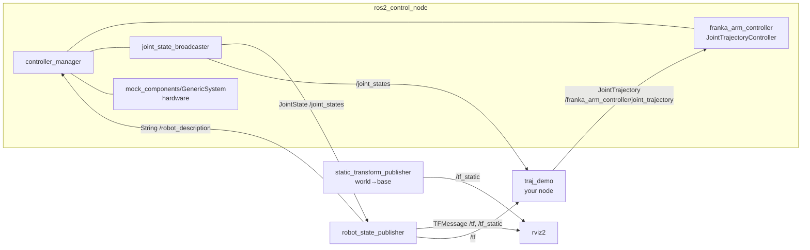

# Module 01: The ROS 2 graph (nodes, topics, services, actions, DDS, QoS)

> **Part I · ROS 2 foundations** · Est. 15–20 h · Prerequisites: 00 · Track A

## Why this matters / where it lives in this repo

Everything in the labs is a **graph of processes exchanging typed messages**. Take
Lab 2's [`bringup.launch.py`](../Lab2/trajectory_demo/launch/bringup.launch.py) plus
your `traj_demo` node:



Lab 1 is a smaller version of the same graph: `joint_state_publisher_gui` →
`/joint_states` → `robot_state_publisher` → `/tf` → RViz, and your FK node runs in
parallel and publishes a second tree under the `my_robot/` prefix.

If you can't draw this diagram from `ros2 node list`, `ros2 topic list -t` and
`ros2 node info`, you can't debug the labs. After this module you will be able to,
and you'll understand what happens below the API.

## Learning objectives

* Explain the ROS 2 stack: **rclcpp/rclpy → rcl → rmw → DDS/Zenoh**, and what each
  layer is responsible for.
* Choose correctly between **topics, services and actions**, and use each from C++ and
  Python.
* Read and write **interface definitions** (`.msg`, `.srv`, `.action`) and know the
  common ones: `std_msgs/Header`, `sensor_msgs/JointState`,
  `geometry_msgs/TransformStamped`, `trajectory_msgs/JointTrajectory`,
  `control_msgs/action/FollowJointTrajectory`.
* Configure **QoS** and predict when a publisher/subscriber pair is incompatible.
* Use **names, namespaces and remapping**. The Lab 2 launch file remaps
  `/controller_manager/robot_description` to `/robot_description`. Know why.
* Use **parameters**: declare, read, set at runtime, load from YAML.

## Key ideas to own

**The stack.** Your code calls `rclcpp`/`rclpy`. Both wrap `rcl` (C), which talks to
the abstract `rmw` interface. An `rmw_*` implementation maps that onto a transport:
Fast DDS (Humble default), Cyclone DDS, or Zenoh (`rmw_zenoh`, Jazzy and later). Message
types are generated by `rosidl` from IDL into C, C++ and Python, along with type support
that serialises them (CDR encoding for DDS).

**Topics** are anonymous, many-to-many, typed, asynchronous streams. Publishers don't
know who listens. Use them for *continuous state* (joint states, TF, sensor data).

**Services** are request/response. Use them for *fast, bounded computations or
queries* (e.g. "compute IK for this pose"). Never block on a synchronous service call
inside a callback on a single-threaded executor; Module 02 shows the deadlock.

**Actions** are goal → feedback stream → result, with cancellation and preemption, built
from services and topics. Use them for *long-running, observable tasks*. The JTC exposes
`/<controller>/follow_joint_trajectory` (`control_msgs/action/FollowJointTrajectory`).
Lab 2 instead publishes on the controller's `~/joint_trajectory` topic. That is
fire-and-forget: no acceptance, no feedback, no result, no error code if a joint name is
wrong. Actions are what production code uses.

**Messages you must know cold**

* `std_msgs/Header`: `stamp` (time) and `frame_id` (the frame the data is expressed in).
  Module 06 covers why both matter.
* `sensor_msgs/JointState`: **parallel arrays** `name[]`, `position[]`, `velocity[]`,
  `effort[]`. There is **no guaranteed ordering**, so always index by name:
  `q = dict(zip(msg.name, msg.position))`. Any code that assumes the order of
  `msg.name` matches your kinematic chain has a latent bug.
* `trajectory_msgs/JointTrajectory`: `joint_names[]` plus `points[]`. Each point has
  `positions`, `velocities`, `accelerations`, `effort`, and `time_from_start`
  (a duration measured from the trajectory's `header.stamp`, *not* from the previous
  point). A zero stamp means "start now".
* `geometry_msgs/TransformStamped` and `tf2_msgs/TFMessage` (a list of them), covered
  in Module 06.

**QoS (Quality of Service)** is a per-endpoint contract. The policies:

| Policy | Options | Notes |
|---|---|---|
| Reliability | `RELIABLE` / `BEST_EFFORT` | Reliable retransmits. Best-effort drops under load (right for high-rate sensors) |
| Durability | `VOLATILE` / `TRANSIENT_LOCAL` | Transient-local stores the last *depth* messages for late joiners. `/tf_static` and `/robot_description` use it |
| History | `KEEP_LAST(depth)` / `KEEP_ALL` | Queue behaviour |
| Deadline, lifespan, liveliness | durations | Monitoring and expiry |

**Compatibility is "request ≤ offer":** a `RELIABLE` subscriber will **not** connect to
a `BEST_EFFORT` publisher, and a `TRANSIENT_LOCAL` subscriber will not connect to a
`VOLATILE` publisher. The reverse pairs work. Mismatches are silent unless you look
(`ros2 topic info -v <topic>` prints the QoS of every endpoint, and recent distros log
an "incompatible QoS" warning).

**Discovery.** DDS participants find each other by multicast (SPDP/SEDP) on UDP ports
derived from `ROS_DOMAIN_ID`. Networks that block multicast (many university and cloud
networks) need a discovery server (Fast DDS), static peers (Cyclone) or a Zenoh router.

**Names.** `joint_states` is relative (resolved under the node's namespace),
`/joint_states` is absolute, and `~/joint_trajectory` is private (under the node's own
name, which is how the JTC gets `/franka_arm_controller/joint_trajectory`). Remapping
(`--ros-args -r from:=to`, or `remappings=[...]` in launch) rewires names without code
changes.

**Parameters** are typed, per-node and must be declared (`declare_parameter`, as Lab 2's
node does for `base_link`, `ee_link`, …). Set them on the command line with
`--ros-args -p name:=value`, from YAML (`node_name: ros__parameters: {...}`, the format
of [`ros2_controllers.yaml`](../Lab2/trajectory_demo/cfg/ros2_controllers.yaml)), or at
runtime with `ros2 param set`. Nodes can validate changes in a set-parameters callback.

**Minimal C++ publisher** (compare its shape with `traj_demo.py`):

```cpp
#include <chrono>
#include <cmath>
#include <rclcpp/rclcpp.hpp>
#include <sensor_msgs/msg/joint_state.hpp>

using namespace std::chrono_literals;

class SineJoints : public rclcpp::Node {
public:
  SineJoints() : Node("sine_joints") {
    pub_ = create_publisher<sensor_msgs::msg::JointState>("joint_states", rclcpp::QoS(10));
    timer_ = create_wall_timer(10ms, [this] {
      sensor_msgs::msg::JointState msg;
      msg.header.stamp = now();
      for (int i = 1; i <= 7; ++i) msg.name.push_back("fr3_joint" + std::to_string(i));
      msg.position.assign(7, 0.0);
      msg.position[3] = -1.5 + 0.5 * std::sin(now().seconds());
      pub_->publish(msg);
    });
  }

private:
  rclcpp::Publisher<sensor_msgs::msg::JointState>::SharedPtr pub_;
  rclcpp::TimerBase::SharedPtr timer_;
};

int main(int argc, char ** argv) {
  rclcpp::init(argc, argv);
  rclcpp::spin(std::make_shared<SineJoints>());
  rclcpp::shutdown();
}
```

## Study materials

**Core**

| Resource | Take from it |
|---|---|
| ROS 2 docs, [Beginner: CLI tools](https://docs.ros.org/en/humble/Tutorials/Beginner-CLI-Tools.html) (all of it) | Nodes, topics, services, parameters, actions from the command line |
| ROS 2 docs, [Beginner: Client libraries](https://docs.ros.org/en/humble/Tutorials/Beginner-Client-Libraries.html) | Pub/sub, services, custom interfaces, parameters in **both** C++ and Python. Do both languages |
| [Writing an action server and client (C++)](https://docs.ros.org/en/humble/Tutorials/Intermediate/Writing-an-Action-Server-Client/Cpp.html) / [(Python)](https://docs.ros.org/en/humble/Tutorials/Intermediate/Writing-an-Action-Server-Client/Py.html) | Goal handles, feedback, cancel |
| [Quality of Service settings](https://docs.ros.org/en/humble/Concepts/Intermediate/About-Quality-of-Service-Settings.html) | Policies, compatibility table, QoS events |
| F. Martín Rico, *A Concise Introduction to Robot Programming with ROS 2* (CRC Press), with code at [fmrico/book_ros2](https://github.com/fmrico/book_ros2) | The best C++-first ROS 2 book. Chapters 1–3 here, the rest later |

**Deeper**

| Resource | Take from it |
|---|---|
| [ROS 2 design articles](https://design.ros2.org/): "ROS on DDS", "Actions", "Topic and Service name mapping to DDS" | *Why* the API looks the way it does |
| Macenski et al., "Robot Operating System 2: Design, architecture, and uses in the wild", *Science Robotics* 2022 ([arXiv:2211.07752](https://arxiv.org/abs/2211.07752)) | Architecture overview and the design rationale |
| [ROS 2 Concepts index](https://docs.ros.org/en/humble/Concepts.html): "Interfaces", "Different middleware vendors", "Composition" | Reference reading |
| [ros2/rmw_zenoh](https://github.com/ros2/rmw_zenoh) README | A non-DDS middleware and its router-based discovery |
| Kronauer et al., "Latency Analysis of ROS2 Multi-Node Systems" (2021, [arXiv:2101.02074](https://arxiv.org/abs/2101.02074)) | How to measure latency properly. Read before the mini project |
| [Robotics Back-End](https://roboticsbackend.com/) ROS 2 tutorials, and Articulated Robotics on YouTube | Gentle video and text walkthroughs if the docs feel dry |

## Warm-ups

1. **Map Lab 2.** Bring up Lab 2 (`bringup.launch.py`) and, using only the CLI, produce the
   diagram above yourself. Use `ros2 node list`, `ros2 node info /robot_state_publisher`,
   `ros2 topic info -v /tf_static`, `ros2 topic info -v /robot_description`,
   `ros2 action list -t` and `ros2 control list_controllers`. Note which topics are
   transient-local.
2. **Dancing robot.** Build the `SineJoints` node above in a C++ package and use it in
   place of `joint_state_publisher_gui` in a copy of Lab 1's launch. The arm should move
   by itself in RViz.
3. **QoS mismatch.** Write a Python subscriber to `/tf_static` with *volatile* durability,
   start it after `robot_state_publisher`, and observe that nothing arrives. Fix it.
   Then make a `BEST_EFFORT` publisher and a `RELIABLE` subscriber and observe silence.
4. **Action vs topic.** Send the Lab 2 example trajectory through the action interface
   (`ros2 action send_goal /franka_arm_controller/follow_joint_trajectory control_msgs/action/FollowJointTrajectory "{trajectory: {...}}" --feedback`).
   Compare what you learn with the `ros2 topic pub` version. Then send a goal with a
   misspelled joint name both ways.
5. **Custom interface.** Create `mamp_interfaces` with `CartesianWaypoint.msg`
   (`geometry_msgs/Pose pose`, `builtin_interfaces/Duration time_from_start`) and an
   action `FollowCartesianPath.action`. You will reuse them in Modules 10 and 13.

## Mini project: measure the middleware, don't guess

### Part A: an action relay on Lab 2 *(A)*

Write a C++ action server `/mamp/execute_trajectory` (your `FollowCartesianPath` or a
re-typed `FollowJointTrajectory`). It validates goals (joint names and limits from the
URDF, monotonically increasing `time_from_start`), forwards them to the JTC's action,
relays feedback, supports cancel, and returns a structured result.

*Proof:* a `launch_testing` test (Module 03) that (i) sends a valid goal and receives
`SUCCESS`, (ii) sends a goal with an out-of-limit position and gets a rejection, and
(iii) cancels mid-execution and observes the arm stop.

### Part B: a communication benchmark (B)

Build `mamp_comm_bench`, a ping-pong (round-trip) latency and throughput benchmark.

* **Payloads:** 64 B, 4 KB, 256 KB, 4 MB (a byte array or a `PointCloud2`).
* **Rates:** 10 Hz, 100 Hz, 1 kHz.
* **Factors:** language (rclcpp vs rclpy); RMW (Fast DDS vs Cyclone, plus Zenoh on Jazzy);
  QoS (reliable/best-effort, depth 1/10); topology (intra-process composable node, two
  processes, two containers); network impairment with `tc qdisc ... netem loss 5% delay 10ms`.
* **Metrics:** latency distribution (p50/p99/p99.9/max), loss rate, CPU per process.

**Proof of competence**

* A short report (plots of CDFs, not just means) answering: Where does rclpy's overhead
  come from? At what payload size do Fast DDS and Cyclone diverge, and why? What happens to
  reliable QoS under 5% loss at 1 kHz? When is intra-process zero-copy actually zero-copy?
* Every claim in the report is backed by a reproducible script (`make bench`).

**Stretch**

* A **QoS doctor** node: periodically queries `get_publishers_info_by_topic` and
  `get_subscriptions_info_by_topic` for every topic and reports incompatible pairs, with a
  fix suggestion.
* Repeat a subset of the benchmark with shared-memory transport enabled and explain the
  difference for 4 MB payloads.

## Self-check

1. Why does RViz, started *after* `robot_state_publisher`, still show the static
   `world → base` transform, while a late `ros2 topic echo /joint_states` shows only new
   messages?
2. Predict connectivity: (best-effort pub, reliable sub), (reliable pub, best-effort sub),
   (volatile pub, transient-local sub).
3. Choose topic, service or action for: streaming joint states; "solve IK for this pose";
   "execute this 10 s trajectory". Justify each.
4. What exactly does `time_from_start` mean, and relative to what?
5. Why is publishing on `/franka_arm_controller/joint_trajectory` less robust than using
   the action? Name three failure modes you can't detect.
6. What does the `rmw` abstraction buy you, and what does it cost?
7. Where does the Lab 2 launch file use remapping, and what breaks if you delete it?

Next: [Module 02: Execution model](02-ros2-execution-model.md)
