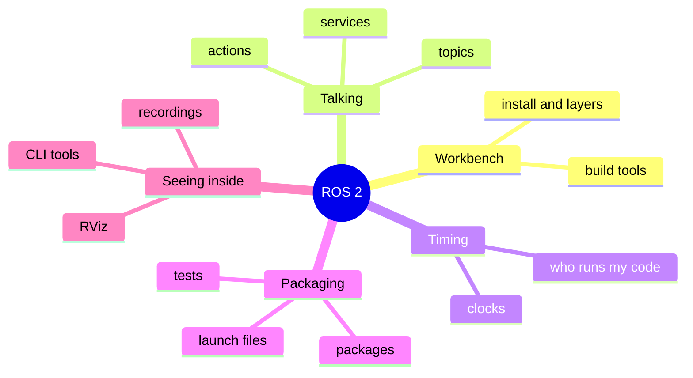
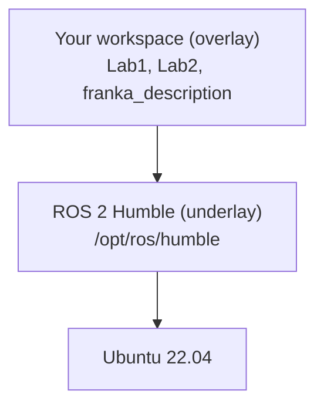
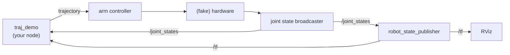
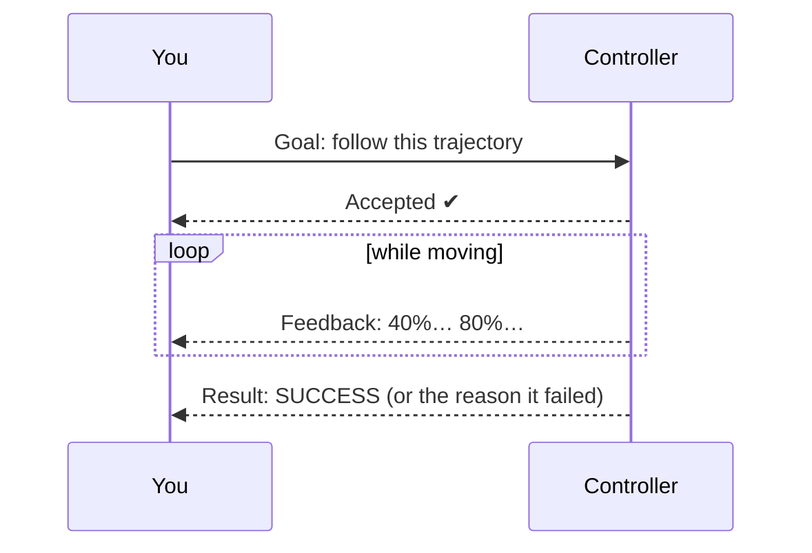
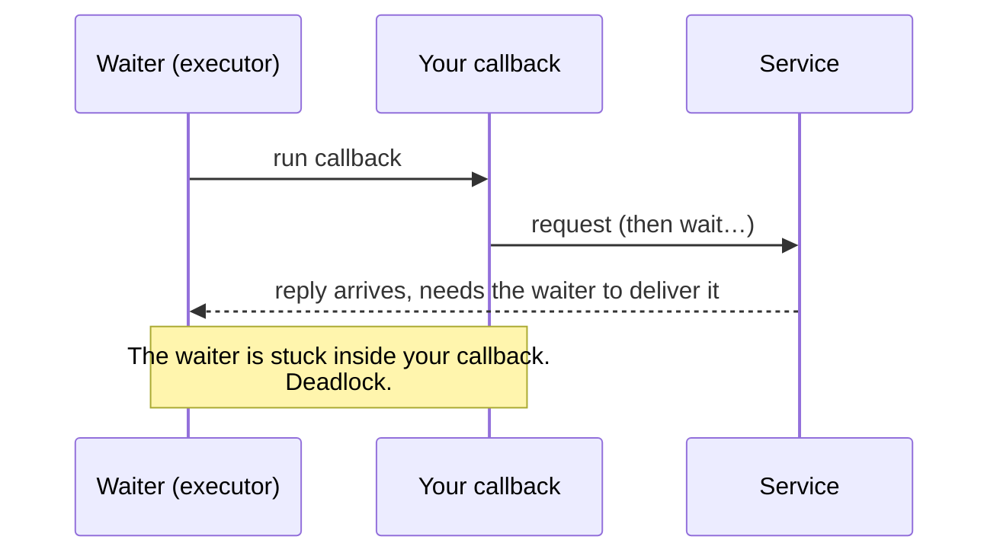
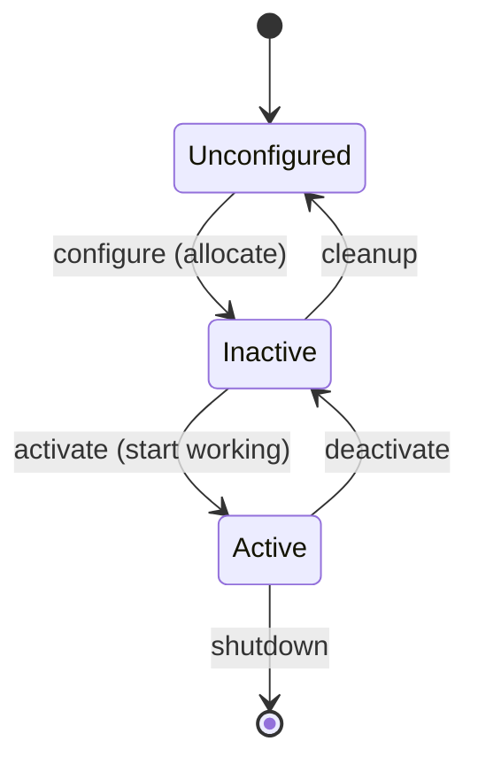
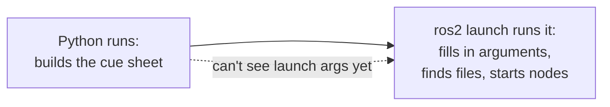
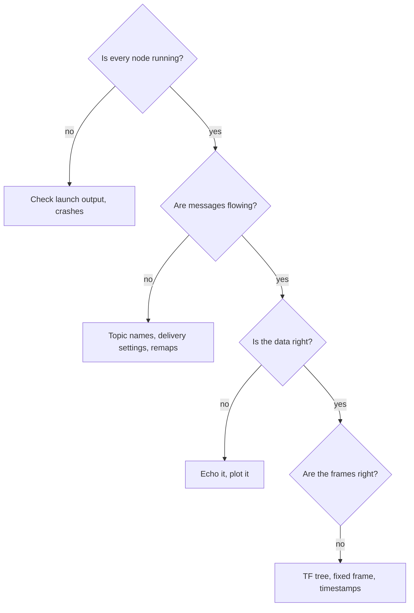

# Chapter 1 · Talking: how robot software works

A robot isn't one big program. It's a crowd of small programs, each doing one job well
(read the joints, draw the screen, plan a path), and they constantly pass messages to
each other. **ROS 2** is the postal service, the rulebook and the toolbox for that crowd.
Learn how the crowd talks and you can debug anything in the labs.

---

## 1.0 · Set up the workbench

*Why does `ros2: command not found` happen, and why does "source" fix it?*

ROS 2 is just a folder of programs and libraries (`/opt/ros/humble`). "Sourcing" it
tells your terminal where that folder is. Your own code lives in a **workspace** that
sits *on top* like a transparent sheet: where your sheet has something, it wins.

**In this repo:** Lab 1 has a conda recipe (`Lab1/env.yml`), Lab 2 installs with apt.
Lab 2 also imports `youbot_kinematics`, which isn't in this repo, so get it from the course
materials. 🧩 *Puzzle:* `Lab2/trajectory_demo/package.xml` lists no run-time
dependencies. What breaks because of that?

**Look up:** *colcon*, *rosdep*, *underlay/overlay*, *ROS_DOMAIN_ID*, *ROS 2 Docker*,
*RoboStack*. Read the [ROS 2 Humble install and beginner pages](https://docs.ros.org/en/humble/).

**🛠 Prove it:** Package this repo in a container: one command takes a fresh laptop to RViz
showing the arm. *Passed when* a classmate gets there in under 10 minutes and an
automatic test (CI) fails if you break the robot model.

---

## 1.1 · Three ways to talk

*How does the trajectory you publish in Lab 2 end up moving the arm on screen?*

Each program is a **node**. Nodes talk in three styles:

| Style | Everyday version | Use it for |
|---|---|---|
| **Topic** | A radio station: anyone can broadcast, anyone can tune in | Continuous streams (joint angles, camera images) |
| **Service** | A phone call: ask, wait, get an answer | Quick questions ("solve IK for this pose") |
| **Action** | Ordering a pizza with live tracking, and you can cancel | Long jobs ("follow this 10-second trajectory") |

Here is Lab 2, drawn as who-talks-to-whom:

Lab 2 sends its trajectory as a *topic*, which is shouting into the void. The
*action* version tells you whether the goal was accepted, how it's going and whether
it worked:

Two headlines worth tattooing:
* **Joint-state messages are lists of names and values in no promised order.**
  Always match values to joints by name.
* **Delivery settings (QoS) must be compatible.** Think postcards (fast, may get lost)
  vs registered post (guaranteed). A sender of postcards can't satisfy a reader who
  demands registered post, and they silently never connect. Some topics also pin their
  last message to a noticeboard for latecomers (that's how RViz sees the robot model
  even if it starts last).

**Look up:** *ROS 2 topics/services/actions*, *QoS reliability and durability*,
*remapping*, *parameters*, *DDS*. Read the ROS 2 docs
[beginner tutorials](https://docs.ros.org/en/humble/Tutorials.html) in both C++ and
Python, then Martín Rico's *A Concise Introduction to Robot Programming with ROS 2*.

**🛠 Prove it:** (a) Write an action server that checks trajectories (joint names,
limits, timing) before passing them to Lab 2's controller. *Passed when* tests show a
good goal succeeds, a bad one is rejected and a cancel stops the arm. (b) Measure
message delay across languages and delivery settings. *Passed when* every claim in your
write-up has a graph and a script behind it.

---

## 1.2 · Who actually runs your code?

*Why does a node sometimes freeze forever when nothing is "wrong"?*

Your callback functions don't run by themselves. An **executor** runs them, by default
one at a time, like a single waiter serving every table. If the waiter stands at one
table waiting for the kitchen, and the kitchen's reply has to be delivered *by that
same waiter*, everyone waits forever.

The same trap catches Python TF lookups that wait for data inside a callback. Fixes: don't
block (ask asynchronously), or hire more waiters with separate queues (callback groups and a
multi-threaded executor).

Two more ideas:
* **Clocks.** Wall-clock time vs simulated time. In simulation everyone must follow the
  simulator's clock.
* **Lifecycles.** Well-behaved nodes have a start-up routine, which is exactly how robot
  controllers are switched on:

**Real-time** means *never late*, not *fast*. A 1 kHz control loop must never allocate
memory, wait on locks or write files.

**Look up:** *ROS 2 executors*, *callback groups*, *use_sim_time*, *lifecycle nodes*,
*component composition*, *PREEMPT_RT*. Read the [executors page](https://docs.ros.org/en/humble/Concepts/Intermediate/About-Executors.html).

**🛠 Prove it:** Build the freeze on purpose, then fix it three ways. Then build a
1 kHz sensor → filter → controller chain in C++. *Passed when* it misses zero
deadlines in 10 minutes while the computer is under heavy load.

---

## 1.3 · Packages, launch files and tests

*How does one command start eight programs with the right settings?*

A **package** is a labelled box: code, plus a manifest saying what it needs. A
**launch file** is a stage manager's cue sheet: which programs, with which settings, in
what order. One subtlety trips everyone up. Launch files are *written* first and
*filled in* later:

Test at three levels: small pure-maths tests (milliseconds), node tests, and whole-system
launch tests. Keep algorithms out of your ROS nodes so the first kind is easy to write.

**In this repo:** compare the two build styles: `franka_description/CMakeLists.txt`
(C++-style) vs `Lab1/transform_helpers/setup.py` (Python-style). Compare the two launch
styles: Lab 1's declarative launch file vs `franka_description`'s `OpaqueFunction` one.

**Look up:** *ament_cmake vs ament_python*, *launch substitutions*, *event handlers*,
*launch_testing*, *package.xml format 3*.

**🛠 Prove it:** One launch file that brings up 1–4 arms side by side from settings
alone. *Passed when* an automatic test starts two arms headless, moves each one and checks
the other didn't move.

---

## 1.4 · Seeing inside the machine

*The robot isn't moving. Where do you even start?*

Your toolkit: the `ros2` command line, `rqt_graph` (the who-talks-to-whom picture),
**RViz** (3-D view), **PlotJuggler** (graphs over time) and **bags** (flight recorders
you can replay later).

**Look up:** *ros2 topic info -v*, *rosbag2 MCAP*, *RViz markers*, *tf2_echo*,
*PlotJuggler*, *gdb launch prefix*.

**🛠 Prove it:** A "flight recorder": record a Lab 2 run, then use a stand-alone script to
rebuild the hand's path from the recording and draw it. Add a live RViz overlay of the
hand's trail. *Passed when* your rebuilt path matches the live one to a billionth of a
metre.

---

**The story so far:** you can make programs talk, schedule them, package them and spy
on them. But every message so far says things like "joint 3 is at 1.2 rad" or "the hand
is *there*". Next: what "there" actually means.

Next → [Chapter 2 · Space](2-space.md)
