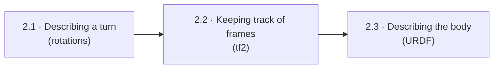
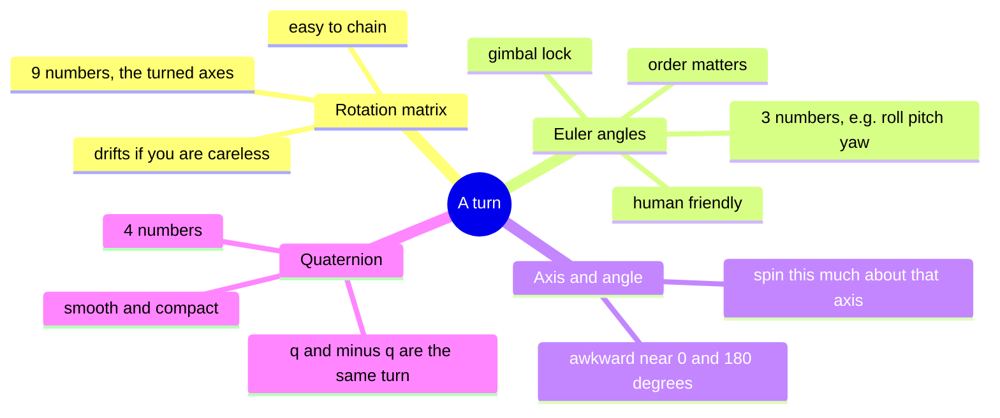
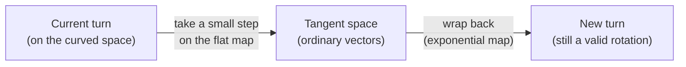
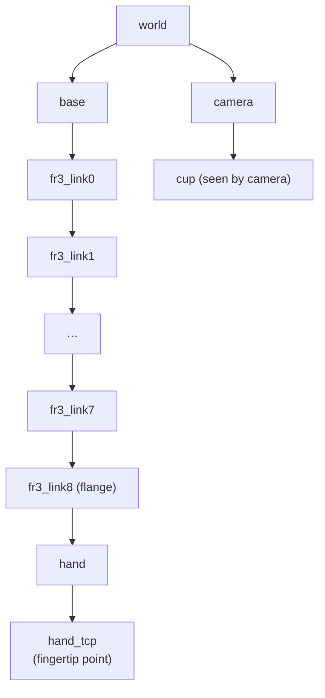
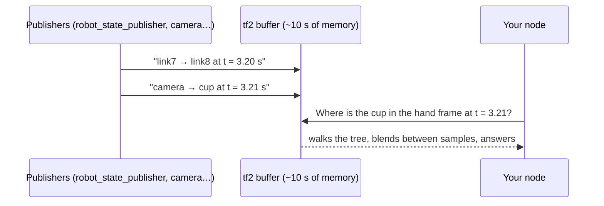
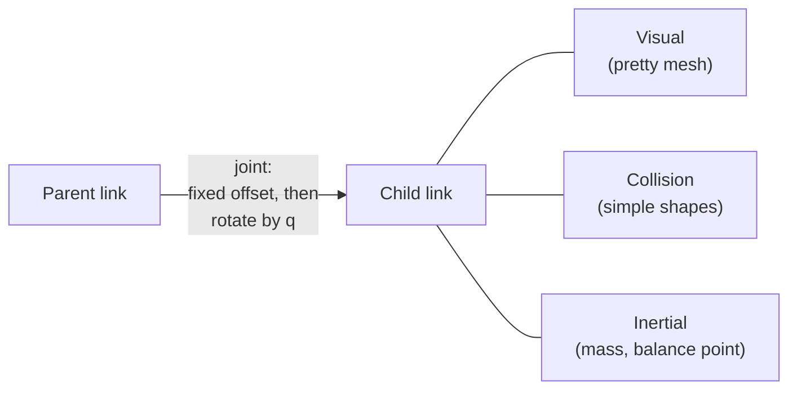
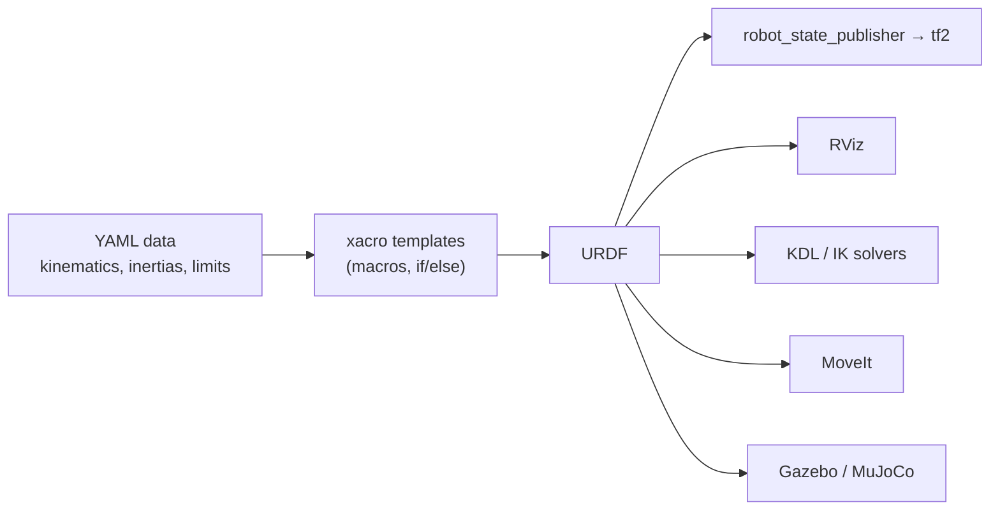

# Chapter 2 · Space: where is everything?

"The cup is 40 cm in front of the robot, tilted slightly left." Every word of that
needs a precise meaning: *front of what? measured how? tilted about which axis?* This
chapter builds that language: frames, rotations, the ROS tool that tracks them (tf2),
and the file that describes the robot's body (URDF).

---

## 2.1 · Describing a turn

*How many numbers does it take to say "which way round" something is, and why do
all the obvious answers break?*

A **frame** is a little set of x-y-z axes stuck to something: the table, the base, the
gripper. A **pose** says where one frame is relative to another. It has two parts:
*where* (a shift) and *which way round* (a turn). Shifts are easy. Turns are the whole
difficulty, because there are four common ways to write one down and each has a catch:

Three headlines:
* **Order matters.** Turn a book 90° about x then y, then try y then x. You'll get
  different results. Every library picks an order and a convention, and silently
  mixing them is the #1 bug.
* **Know your quaternion's field order.** ROS stores it as `x, y, z, w`. Some libraries
  put `w` first.
* **The pro view (Lie groups):** all possible turns form a curved space, like the
  Earth's surface. Small changes are easiest to handle on a flat tangent "map" and then
  wrapped back onto the curve. This one idea makes calculus on rotations clean, and it
  reappears in inverse kinematics, optimisation and estimation.

**In this repo:** Lab 1's `utils.py` asks for three conversions between these forms.
URDF writes turns as `rpy` (roll-pitch-yaw); Lab 2 builds `PyKDL.Rotation.RPY`. Can you
say exactly which axes and in what order?

**Look up:** *SO(3), SE(3)*, *intrinsic vs extrinsic Euler angles*, *gimbal lock*,
*quaternion double cover*, *slerp*, *exponential map*, *adjoint*. Read *Modern Robotics*
Ch. 3, Solà's [*A micro Lie theory*](https://arxiv.org/abs/1812.01537), and play with
[eater.net/quaternions](https://eater.net/quaternions).

**🛠 Prove it:** Write your own small rotation/pose library (C++ with Python bindings) and
attack it with random tests. *Passed when* a million conversions in every direction
come back exact (to 1e-12), **including exactly 180°**, the case that breaks naive code.

---

## 2.2 · Keeping track of frames (tf2)

*The camera sees a cup. Where is the cup relative to the gripper, right now and
half a second ago?*

**tf2** keeps a family tree of every frame on the robot, plus a short memory of how
each link moved. Ask it "where is X relative to Y at time t?" and it walks the tree and
multiplies the steps together.

Headlines:
* **It must be a tree.** One parent per frame, so there's only ever one route between
  two frames.
* **The argument order is "target ← source".** `lookup(base, hand)` answers "where is
  the hand, in base coordinates?". Say it out loud every time.
* **Stamp data with when it was true**, not when you sent it. tf2 blends between
  samples, but it never guesses the future.
* **Fixed parts are published once and pinned** (`/tf_static`). Moving parts stream
  continuously (`/tf`).

**In this repo:** Lab 1 broadcasts a second tree under `my_robot/` (your own forward
kinematics), side by side with the official one. Lab 2 *listens* to get the hand position.

**Look up:** *tf2 broadcaster/listener*, *lookup_transform*, *time travel*,
*ExtrapolationException*, *REP 103 / REP 105*. Do the
[tf2 tutorials](https://docs.ros.org/en/humble/Tutorials/Intermediate/Tf2/Tf2-Main.html).

**🛠 Prove it:** Build tf2 yourself: a buffer that listens, remembers, blends and
answers. *Passed when* it agrees with the real tf2 on 10,000 random questions from a
recorded Lab 2 run, and refuses the same impossible ones.

---

## 2.3 · Describing the body (URDF)

*How does every tool, from RViz to the planner to the simulator, know the robot's
shape?*

A **URDF** file is the robot's skeleton: **links** (bones) joined by **joints**. Each
joint says: *"from the parent bone, shift and turn by this fixed amount, then rotate
(or slide) by the joint angle q."*

Real descriptions are generated from templates (**xacro**) plus data files, then read
by everything else:

**In this repo:** `franka_description` is a professional example: structure in
`robots/common/*.xacro`, numbers in `robots/fr3/*.yaml`. 🧩 Puzzles worth an evening:
* Why are there more links than joints? (Lab 1 asks this.)
* `utils.xacro`'s capsule macro has a sleeping bug that's harmless for every capsule in
  use today. Find it.
* One YAML file has a duplicated key that nobody noticed.
* One of the three arm models ships an inertia that is *physically impossible*.

**Look up:** *URDF joint origin and axis*, *xacro macros and lazy evaluation*, *visual vs
collision geometry*, *physically consistent inertia*, *SDF*, *MJCF*. Do the
[URDF tutorials](https://docs.ros.org/en/humble/Tutorials/Intermediate/URDF/URDF-Main.html).

**🛠 Prove it:** Design a new robot: a torso on a lift carrying **two** FR3 arms and a
pan-tilt camera, all in xacro. Write a validator that catches physically impossible
data. *Passed when* your robot passes, and your validator finds the impossible inertia
in `franka_description`.

---

**The story so far:** we can say exactly where everything is and describe the robot's
body. Next: if I set the joint angles, where does the hand go, and how do I choose
angles to put the hand where *I* want it?

Next → [Chapter 3 · Kinematics](3-kinematics.md)
