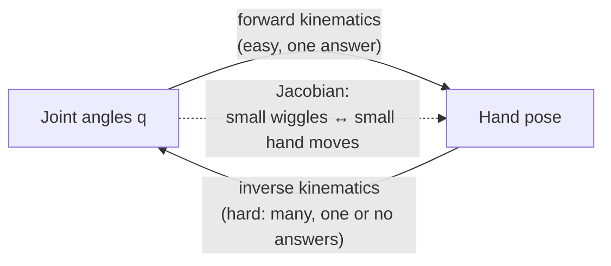
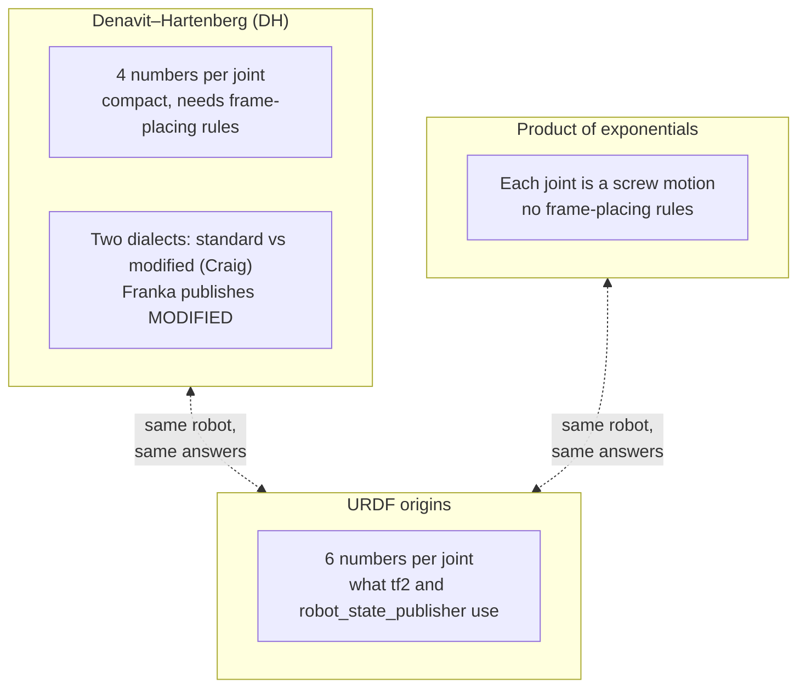
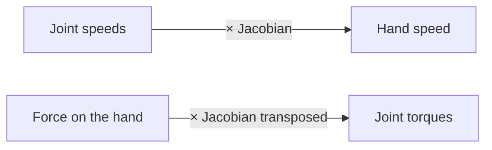
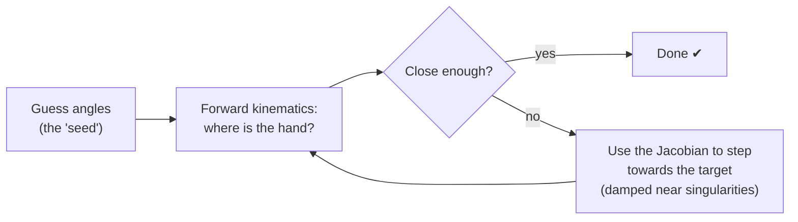

# Chapter 3 · Kinematics: from joints to hand, and back

You know the joint angles. Where's the hand? That's **forward kinematics**, and it's
easy. You know where you *want* the hand. What joint angles get it there? That's
**inverse kinematics**. It's hard, and it's what Lab 2 runs on. Between the two sits
the most useful object in robotics: the **Jacobian**.



---

## 3.1 · Forward kinematics: follow the chain

*If every joint is a little "shift, then turn" instruction, where do you end up after
all seven?*

Walk down the arm from the base. At each joint: shift by a fixed amount, rotate by the
joint angle, and move on to the next bone. Multiply the steps together and you have the
hand's pose.

```text
 base ──shift/turn── joint1(q1) ──shift/turn── joint2(q2) ── … ── joint7(q7) ── flange ── 🖐
        step 1                    step 2                                 step 8
                Hand pose = step1 × step2 × … × step8
```

There are three popular ways to write the "steps":



Headlines:
* **Mixing the two DH dialects is the classic Lab 1 bug.** They put frames on different
  axes and apply steps in a different order.
* **The FR3's URDF origins are its modified-DH table in disguise.** Proving that is a
  lovely afternoon.
* **The FR3's "all joints at zero" pose is outside its joint limits** (joints 4 and 6).
  Lab 2's simulated arm starts there anyway.

**In this repo:** Lab 1's `main.py` holds Franka's modified-DH table (8 rows for 7
joints. Why?). `franka_description/robots/fr3/kinematics.yaml` holds the URDF version.

**Look up:** *modified DH (Craig)*, *standard DH*, *product of exponentials*, *screw
axis*, *workspace*. Read *Modern Robotics* Ch. 4 and Craig's *Introduction to Robotics*
Ch. 3.

**🛠 Prove it** (after submitting Lab 1): Compute the hand pose three ways (DH, PoE,
URDF) in C++. *Passed when* all three agree with the Pinocchio library to 1e-12 over
100,000 random poses, and a tool you wrote extracts a DH table from *any* robot's URDF.

---

## 3.2 · The Jacobian: the gearbox table

*If I nudge joint 2 a tiny bit, which way does the hand move, and how fast?*

The **Jacobian** is a table that answers exactly that, for every joint at once. Read it
forwards and it turns joint speeds into hand speed. Read it backwards (transposed) and
it turns a push on the hand into the torques each joint feels.



Draw the hand speeds you can reach with "one unit of joint effort" and you get an
**ellipsoid**. Where it's fat, the arm moves easily. Where it squashes flat, you're near
a **singularity**: a direction the hand simply can't move, however fast the joints spin.

```text
   comfortable pose            nearly stretched out            fully stretched
        ⬭  (round)               ▬  (flat)                   —  (a line: singular)
   moves well everywhere      struggles outward             can't move outward at all
```

**In this repo:** Lab 2's IK solver uses the Jacobian at every iteration. Near
singularities it slows, wobbles or fails. Lab 2's "not all points can be reached" warning
covers half the story; *badly reachable* points are the other half.

**Look up:** *geometric vs analytic Jacobian*, *space vs body Jacobian*, *manipulability
ellipsoid*, *singular value decomposition*, *statics τ = Jᵀ F*. Read *Modern Robotics*
Ch. 5 and watch Stanford CS223A (Khatib).

**🛠 Prove it:** A live RViz view of the ellipsoid on the FR3's hand as you drag the
joint sliders, plus a "singularity atlas": hunt down every family of singular poses
numerically. *Passed when* your Jacobian matches finite differences and Pinocchio,
and you can explain each family with a sketch.

---

## 3.3 · Inverse kinematics: working backwards

*Put the hand there. Which joint angles do that?*

There may be no answer (too far away), a few answers (elbow up or elbow down), or, for
a 7-joint arm like the FR3, **infinitely many**. Hold a door handle still and swing your
elbow: that's the extra freedom, called **redundancy**.

The usual method is a game of hot-and-cold with a very good compass:



Headlines:
* **The seed decides which answer you get.** Lab 2 seeds each waypoint with the previous
  answer to stay on the same "branch". That works until it suddenly flips.
* **Damping** (Levenberg–Marquardt) trades a little accuracy for stability near
  singularities. That's the "LMA" in Lab 2's solver.
* **Joint limits need deliberate handling.** Lab 2's KDL solver ignores them entirely.
* **The spare freedom is a gift.** Use it to stay away from limits, singularities and
  obstacles.

**In this repo:** 🧩 Lab 2's "position-only" IK builds `PyKDL.Frame(pos)`. What
orientation does that frame contain, and does the solver really ignore it? Read the KDL
source to find out.

**Look up:** *Newton–Raphson IK*, *damped least squares*, *Levenberg–Marquardt*,
*null-space projection*, *TRAC-IK*, *analytical IK for the Franka (He & Liu)*,
*QP-based IK*. Read Buss's short [IK survey](https://mathweb.ucsd.edu/~sbuss/ResearchWeb/ikmethods/iksurvey.pdf)
and *Modern Robotics* Ch. 6.

**🛠 Prove it** (after Lab 2): Your own IK library, plus a race against KDL and TRAC-IK
on 10,000 random targets. *Passed when* you clearly beat KDL's success rate *within
joint limits*, and your solver can trace a 1,000-point circle with no sudden joint
flips.

---

**The story so far:** we can map joints to hand and back. But we've been teleporting.
Real arms have mass, motors have limits, and motion takes time. Next: the physics, and
the timetable.

Next → [Chapter 4 · Forces & time](4-forces-and-time.md)
