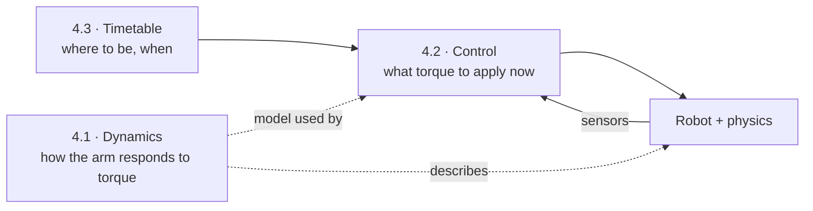
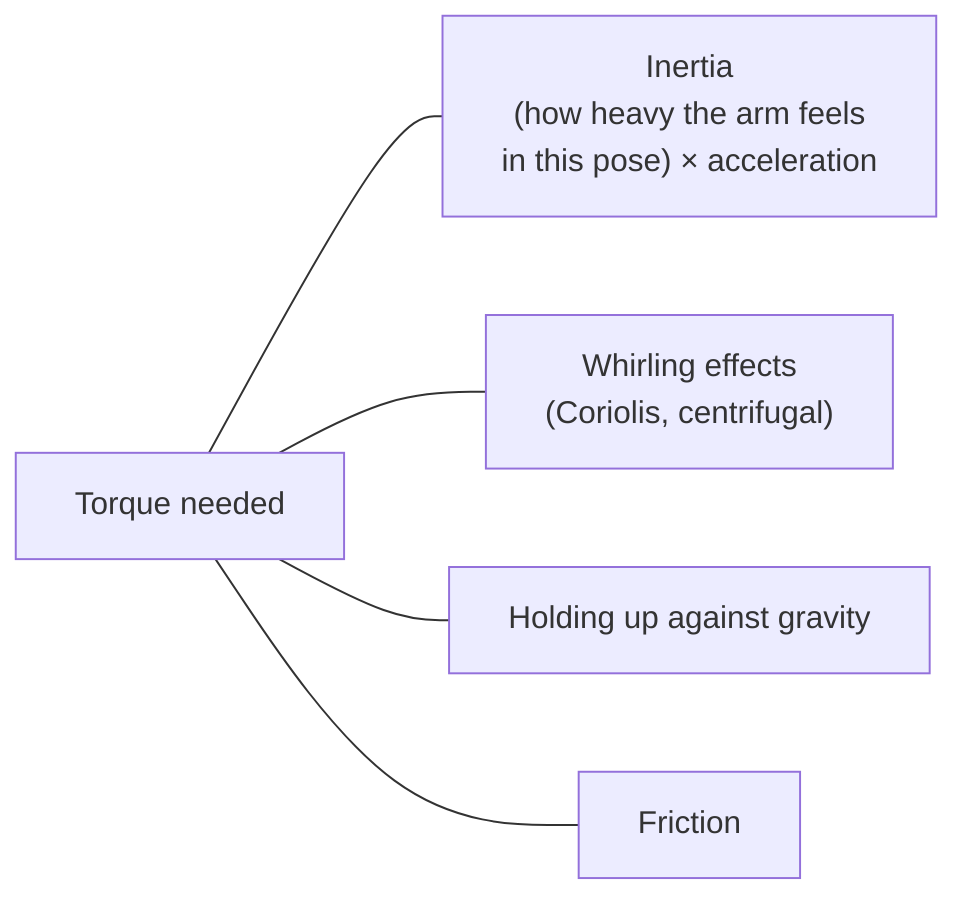
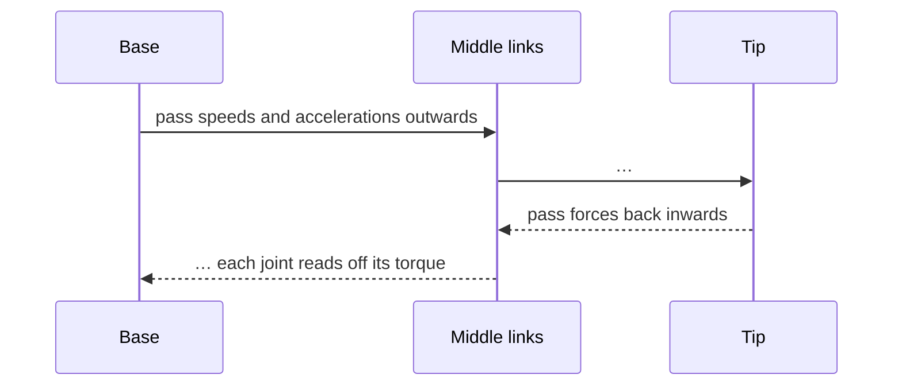
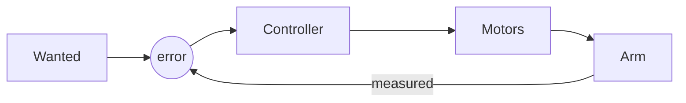
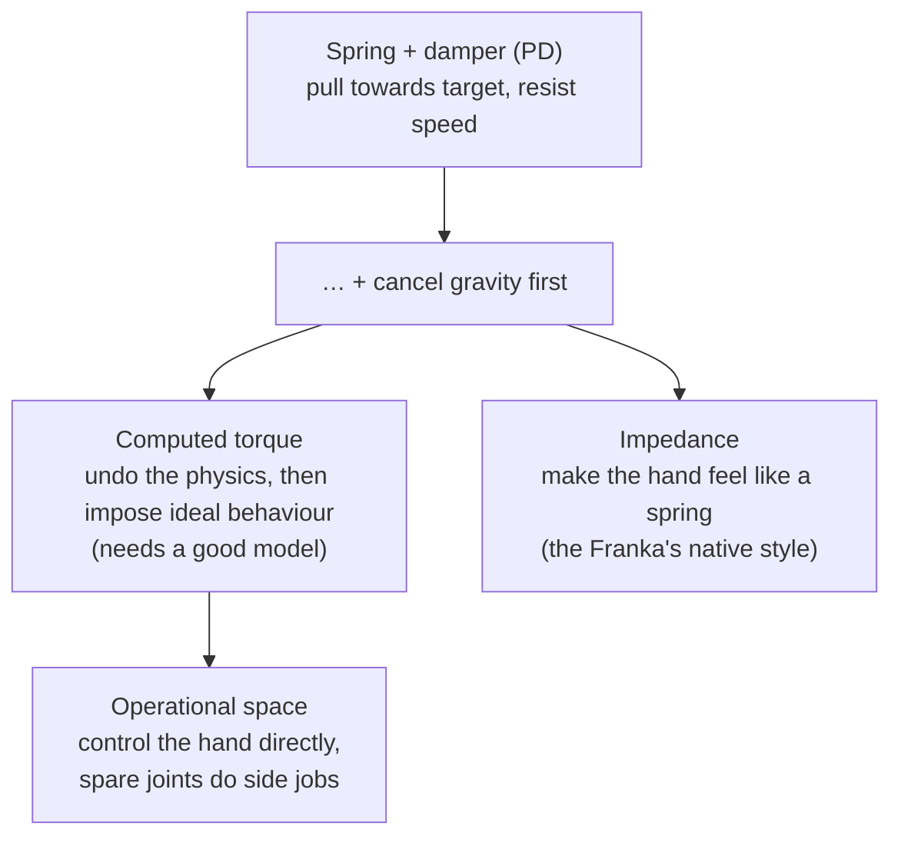
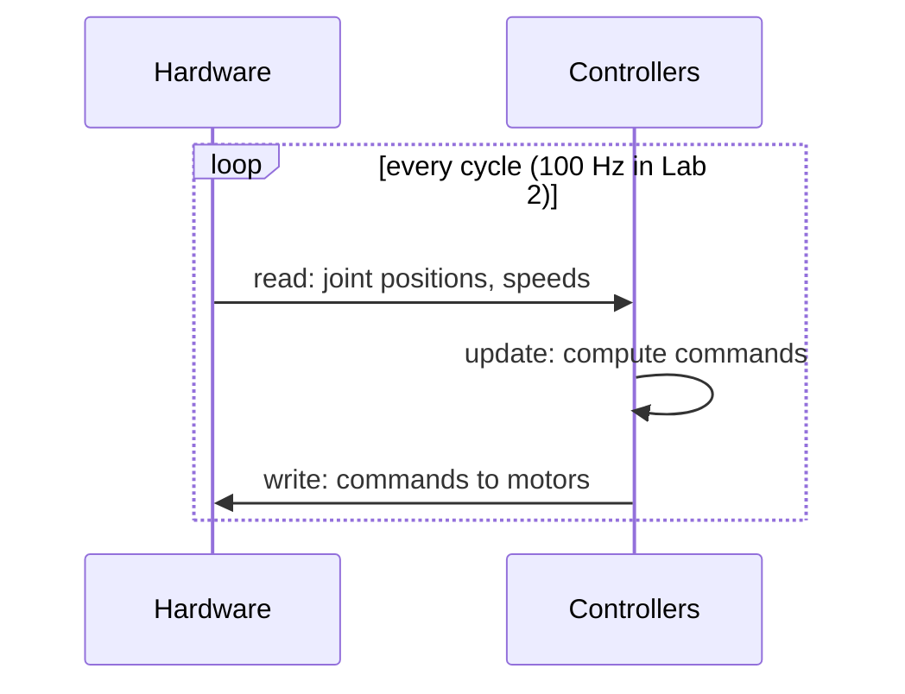
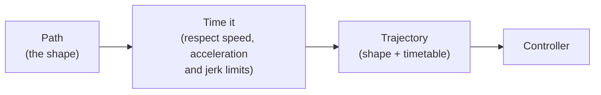

# Chapter 4 · Forces & time: making it actually move

So far the arm has been a ghost: set the angles and it's there. Real arms are heavy,
gravity pulls, motors have limits and nothing happens instantly. This chapter adds the
physics (**dynamics**), the reflexes (**control**) and the timetable (**trajectories**).



---

## 4.1 · Dynamics: why the arm needs torque

*How much twist does each motor need to hold the arm still, and to swing it fast?*

Newton's "force = mass × acceleration", for a chain of linked bodies. In words, the
torque each joint needs is the sum of:



There are elegant ways to compute it all in one sweep along the chain:



That's the **recursive Newton–Euler algorithm**. Its siblings build the "how heavy does it
feel" matrix, or answer the forward question ("given torques, how does it accelerate?").
That forward question is the beating heart of every simulator.

**In this repo:** the masses and inertias live in `robots/fr3/inertials.yaml`, friction
in `dynamics.yaml`, and torque limits in `joint_limits.yaml`. Notice how much weaker the
wrist motors are.

**Look up:** *manipulator equation*, *mass matrix*, *RNEA / CRBA / ABA*, *spatial
vectors (Featherstone)*, *dynamic parameter identification*, *symplectic integration*.
Read *Modern Robotics* Ch. 8, then Featherstone's *Rigid Body Dynamics Algorithms*.

**🛠 Prove it:** Implement all three algorithms for the FR3 from its URDF, plus a tiny
simulator. *Passed when* you match Pinocchio to 1e-10, and a frictionless arm dropped
under gravity keeps its total energy steady for a full minute.

---

## 4.2 · Control: the reflexes

*The arm is 2 cm off target. What torque do you apply this millisecond?*

Every controller lives inside the same loop: compare where you are with where you want to
be, push, measure, repeat.



The family, from simplest to cleverest:



In ROS 2, all of this runs inside **ros2_control**, a strict loop that repeats 100–1000
times a second:



**In this repo:** Lab 2 uses *mock hardware*, a mirror that instantly copies commands into
"measurements". The tracking in your Lab 2 plots is therefore perfect by construction.
You're plotting the plan, not a robot's response.

**Look up:** *PD + gravity compensation*, *computed torque*, *impedance vs admittance*,
*operational space control*, *Lyapunov stability*, *ros2_control hardware interface /
controller plugin*, *joint_trajectory_controller*. Read *Modern Robotics* Ch. 11 and
the [ros2_control docs](https://control.ros.org/humble/index.html).

**🛠 Prove it:** (a) A C++ trajectory controller plugin that never allocates memory in
its loop. (b) Wrap your Chapter 4.1 simulator as ros2_control "hardware" and drive it
with your own impedance controller. *Passed when* (a) matches the stock controller
exactly, and (b) pushing the hand with 10 N moves it by the amount your chosen
stiffness predicts, within 5%.

---

## 4.3 · Trajectories: the timetable

*You have a route. How fast can you drive it?*

A **path** is the route on the map. A **trajectory** is the route *plus* a timetable.
Keep them separate: first decide the shape, then decide the timing.



Headlines:
* **Straight in joint space is curved in the real world.** Interpolating between two IK
  answers swings the hand along an arc. That's why Lab 2 says denser waypoints look
  cleaner.

```text
 target line:   A ─────────────────── B
 joint-space:   A ╮                 ╭ B
                   ╰───────────────╯     ← the hand sags along an arc
```

* **Smoothness is about the derivatives.** Jumps in speed mean infinite acceleration; jumps
  in acceleration mean infinite *jerk*. Real Franka arms refuse jerky commands.

```text
 speed │   ┌────────┐          speed │    ╭──────╮
       │  /          \               │   ╱        ╲
       │ /            \              │ ╭╯          ╰╮
       └──────────────── t           └──────────────── t
         trapezoid: jerky corners      S-curve: smooth (jerk-limited)
```

* **Time-optimal parameterisation** drives a fixed path as fast as every limit allows.
  (TOPP-RA does this; Ruckig re-plans smoothly mid-motion.)

**In this repo:** 🧩 Lab 2 sends positions only, so the controller joins the dots with
straight lines and speed jumps. Also trace how `create_traj` adds up waypoint times. Is
it what the YAML intends?

**Look up:** *path vs trajectory*, *cubic/quintic polynomials*, *trapezoidal and
S-curve profiles*, *time-optimal path parameterisation (TOPP-RA)*, *Ruckig*,
*minimum jerk*. Read *Modern Robotics* Ch. 9.

**🛠 Prove it** (after Lab 2): Robot handwriting. Turn any text in any font into
pen strokes, then strokes into a time-optimal arm motion. *Passed when* the pen stays
within 1 mm of the letters, no speed/acceleration/jerk limit is ever broken, and it beats
a Lab-2-style approach on both time and smoothness.

---

**The story so far:** the arm can now be modelled, controlled and timed. But we've
assumed an empty world. Next: obstacles.

Next → [Chapter 5 · Planning](5-planning.md)
