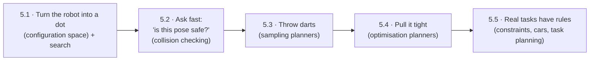
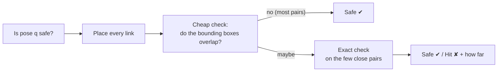
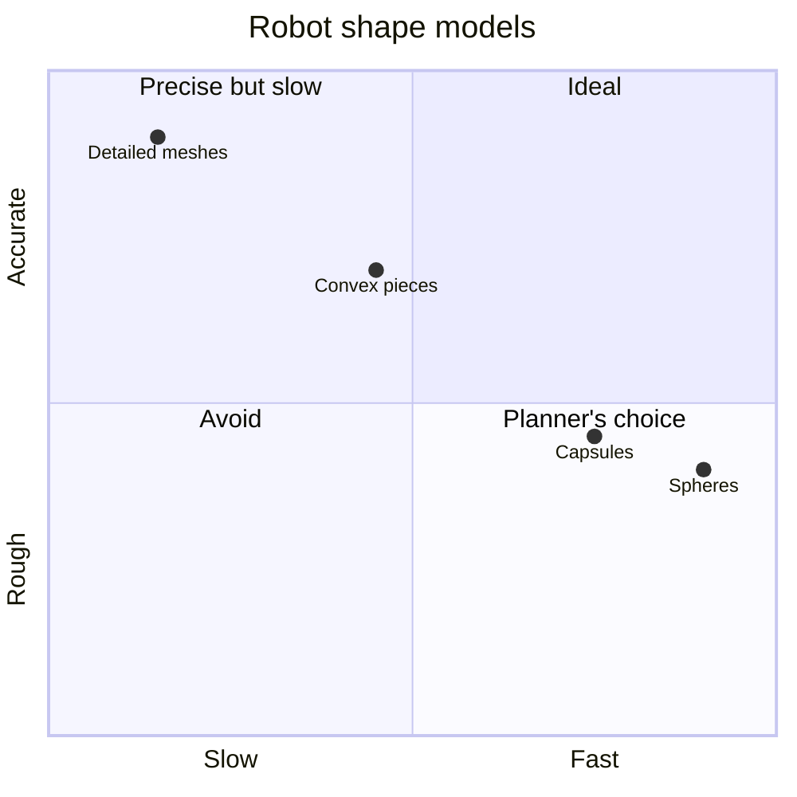
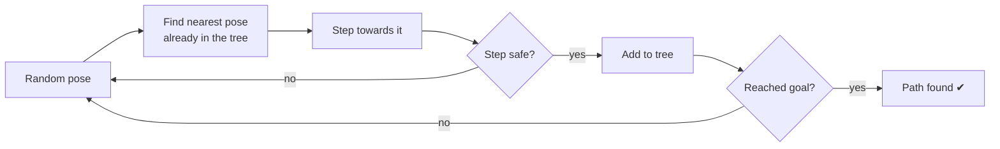
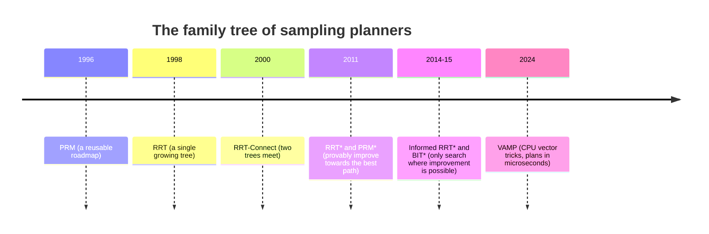
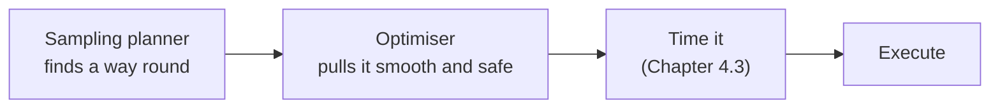
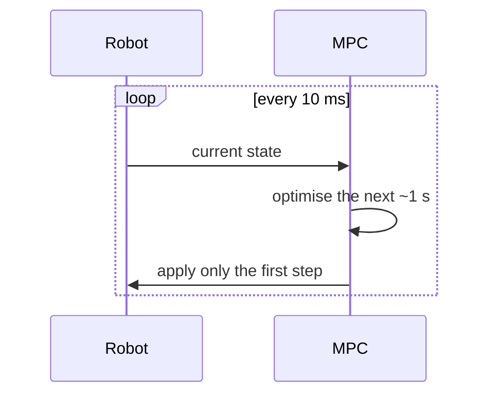
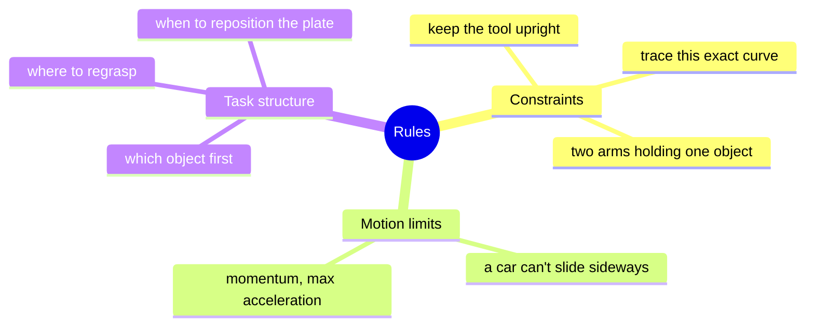
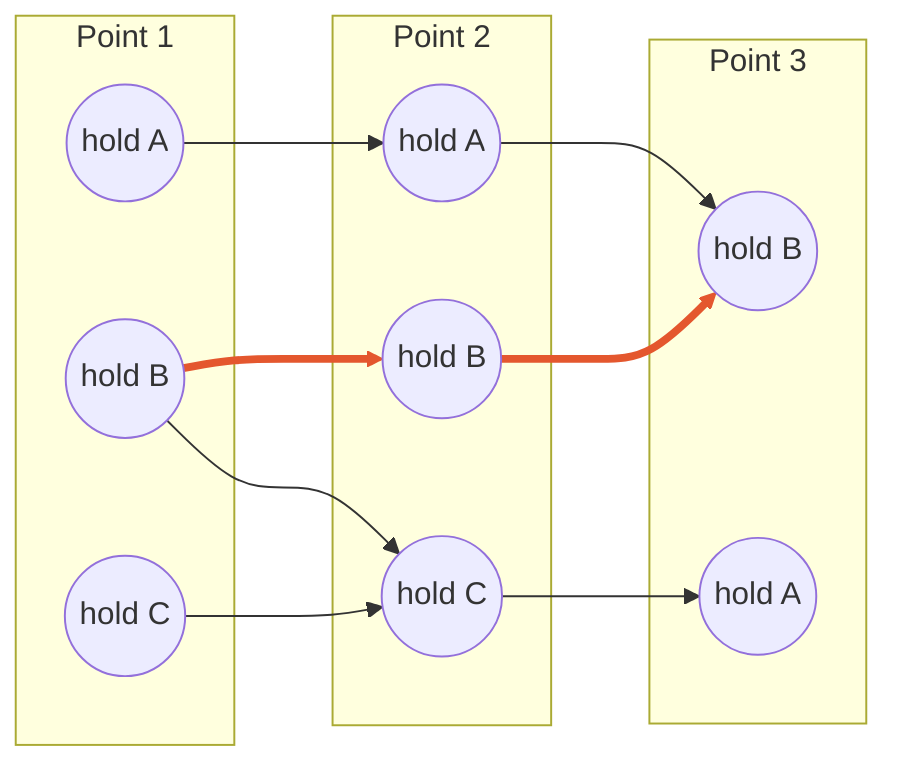

# Chapter 5 · Planning: finding a way through clutter

Lab 2 moves the arm with "no regard for collisions". Real workcells have tables,
shelves, clamps and people. **Motion planning** finds motions that get the job done
without touching anything, and that is the heart of this module. Five ideas, each
fixing the previous one's weakness:



---

## 5.1 · Turn the robot into a dot

*A 7-joint arm has a complicated shape. Can we make planning about moving a single
point instead?*

Yes. Make a giant map where **every point is one complete arm pose** (one value per
joint). That's **configuration space**. The arm becomes a dot. Obstacles become strange
blobs on the map, made of every pose that would cause a crash. Planning means drawing a
line from start dot to goal dot that avoids the blobs.

```text
      THE ROOM (2-joint arm)                    THE MAP (configuration space)
   ┌─────────────────────────┐            joint2 ┌─────────────────────────┐
   │        ▓▓▓  obstacle    │                   │   ░░░░░        ░░░░     │
   │  ●──────●               │       →           │  ░░░░░░░  ★goal ░░      │
   │  base    ╲              │                   │   ░░░░          ░░░     │
   │           ● hand        │                   │ start●    blobs = poses │
   └─────────────────────────┘                   └─────────────────────────┘ joint1
```

For 2 joints you can draw the map. For the FR3's 7, you can't even store it: at
1-degree resolution it has around 10¹⁸ cells. That's why the next lessons never build
the map; they only *probe* it.

On small maps, classic search works:
* **A\*** is GPS-style search, guided by an optimistic guess of the remaining distance.
* **Potential fields** treat the arm as a marble rolling downhill to the goal, pushed
  away by obstacles. Fast, but it gets stuck in dips.

**Look up:** *configuration space*, *C-obstacle*, *Minkowski sum*, *A\* / weighted A\* /
D\* Lite*, *potential fields and local minima*, *completeness*. Read LaValle's *Planning
Algorithms* Ch. 4 and the [Red Blob Games A\* guide](https://www.redblobgames.com/pathfinding/a-star/introduction.html).

**🛠 Prove it:** An interactive app: drag obstacles around a 2-joint arm and watch its
map change live, with A\*, D\* Lite and a potential field racing on it. *Passed when*
you can show the marble getting stuck, and D\* Lite repairing a plan faster than
starting again.

---

## 5.2 · Ask fast: "is this pose safe?"

*Planners ask this question millions of times. How do you answer in microseconds?*

Collision checking is usually **90%+ of planning time**. The trick is to be lazy in two
stages:



How you model the robot's shape is a trade-off:



Headlines:
* **"Sausages" (capsules) and spheres** are tiny to store, quick to test and give smooth
  distances. Franka's own self-collision model uses capsules.
* **Checking a *motion*, not just poses:** test too few points along it and you'll
  tunnel straight through thin walls.
* **Optimisers need more than yes/no.** They need *how far* and *which way is out*
  (signed distance and its gradient).

**In this repo:** `franka_arm.xacro` defines those self-collision capsules (switch on with
`with_sc:=true`).

**Look up:** *broad phase / narrow phase*, *bounding volume hierarchy*, *GJK / EPA*,
*signed distance*, *conservative advancement*, *FCL / Coal*. Read Ericson's
*Real-Time Collision Detection*, and watch Casey Muratori's "Implementing GJK" video.

**🛠 Prove it:** Your own collision library for the FR3. *Passed when* it agrees with
FCL/Coal on a million random tests, never misses a thin-wall collision along a motion,
and checks over a million poses per second on one core.

---

## 5.3 · Throw darts (sampling-based planning)

*The map is too big to draw. What if we just sample it?*

Throw random darts at the map. Keep the ones that land in free space, and connect
neighbours with short safe moves. You never build the map, and you only ever ask
"is this safe?".



That's **RRT**. It grows like frost into empty space. Grow *two* trees, one from the
start and one from the goal, and greedily join them: that's **RRT-Connect**, the
workhorse for robot arms and MoveIt's default. Add rewiring and it keeps improving its
answer towards the best one (**RRT\***).



Two promises to understand: **probabilistic completeness** (given enough darts, it will
find a path if one exists) and **asymptotic optimality** (given enough darts, the answer
approaches the best one). Narrow passages are the enemy of both.

**Look up:** *PRM*, *RRT / RRT-Connect / RRT\**, *Voronoi bias*, *informed sampling*,
*BIT\**, *path shortcutting*, *OMPL*, *Planner Arena*. Read LaValle Ch. 5 and Karaman &
Frazzoli's RRT\* paper ([arXiv:1105.1186](https://arxiv.org/abs/1105.1186)).

**🛠 Prove it:** Write RRT-Connect, RRT\* and PRM in C++ for the FR3 and race them
against OMPL on table, shelf and clutter scenes, using the same collision checker for
both. *Passed when* your RRT-Connect solves 99%+ of problems within a second, in no more
than 1.5× OMPL's time.

---

## 5.4 · Pull it tight (optimisation-based planning)

*Sampled paths are zig-zaggy and ignore what the task cares about. Can we sculpt a
better one?*

Picture the path as a **rope**. Pull it taut (smoothness) while obstacles push it away
(clearance), and keep it inside the rules (joint limits, "keep the cup upright").
That's trajectory optimisation: CHOMP, TrajOpt, STOMP.

Its weakness: a rope starting on the wrong side of a pillar stays there (**local
minima**). So the pros combine both ideas:



Re-run the optimiser every few milliseconds from the latest measurement and you get
**model predictive control (MPC)**: a driver constantly re-planning the next few seconds
of road.



**Look up:** *trajectory optimisation*, *CHOMP / TrajOpt / STOMP*, *SQP*, *direct
collocation*, *iLQR / DDP*, *MPC*, *Graphs of Convex Sets*. Read Kelly's
"An Introduction to Trajectory Optimization" (SIAM Review 2017) and Tedrake's
[*Underactuated Robotics*](https://underactuated.mit.edu/).

**🛠 Prove it:** Build CHOMP and a TrajOpt-style optimiser, warm-started from your
Chapter 5.3 planner, then track the result with MPC while something shoves the arm.
*Passed when* you can show a cold start getting stuck and a warm start fixing it, and
every "success" passes your own independent collision check.

---

## 5.5 · Real tasks have rules

*Lab 2's plasma cutter: the torch must trace a shape, stay upright and move at an
exact speed, while avoiding clamps. Now what?*

Three kinds of "rules" turn up again and again:



* **Constraints** squeeze the valid poses onto a thin "tightrope" through the map, so
  random darts never land exactly on it. You have to *project* each dart onto the rope.
* **Tracing a curve with spare freedom** becomes a "ladder": at each point along the
  curve, list every valid way to hold the tool, then find the smoothest climb.



*(The highlighted route never changes grip, so it's the smoothest climb.)*

* **Cars and other "can't move sideways" systems** need special path shapes (Dubins,
  Reeds–Shepp) or planners that simulate motion forward.
* **Task and motion planning** decides *what* to do and *how* to move at the same time.

**Look up:** *constrained planning / projection*, *Task Space Regions*, *Descartes ladder
graph*, *kinodynamic RRT / SST*, *nonholonomic*, *Dubins / Reeds–Shepp*, *Hybrid A\**,
*TAMP / PDDLStream*. Read Kingston, Moll & Kavraki's 2018 review "Sampling-Based Methods
for Motion Planning with Constraints".

**🛠 Prove it** (after Lab 2): Build the plasma cutter for real: trace shapes on a plate,
torch upright, constant speed, clamps in the way. *Passed when* the tip stays within
0.5 mm, the tilt within 2°, the speed within 5%, with zero collisions. Then compare it
with your Lab 2 essay.

---

**The story so far:** you can plan, sculpt and constrain motions. Next: how industry
packages all of this, how to test it without breaking a real robot, and where machine
learning fits in.

Next → [Chapter 6 · Real world](6-real-world.md)
