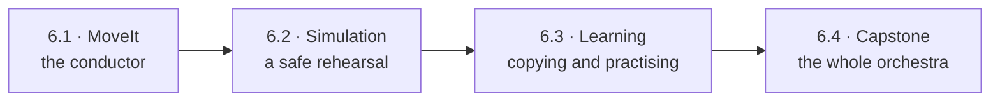
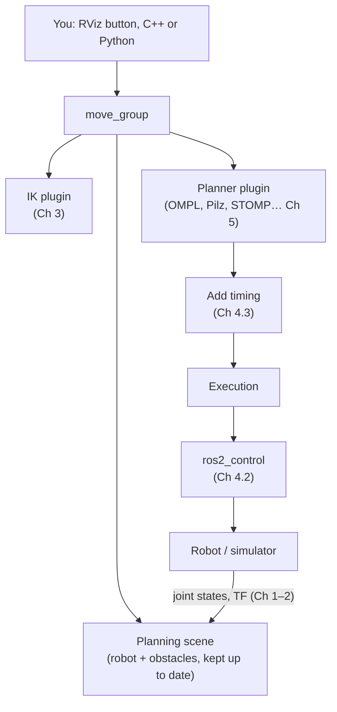
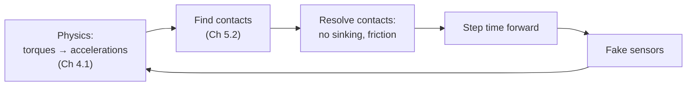
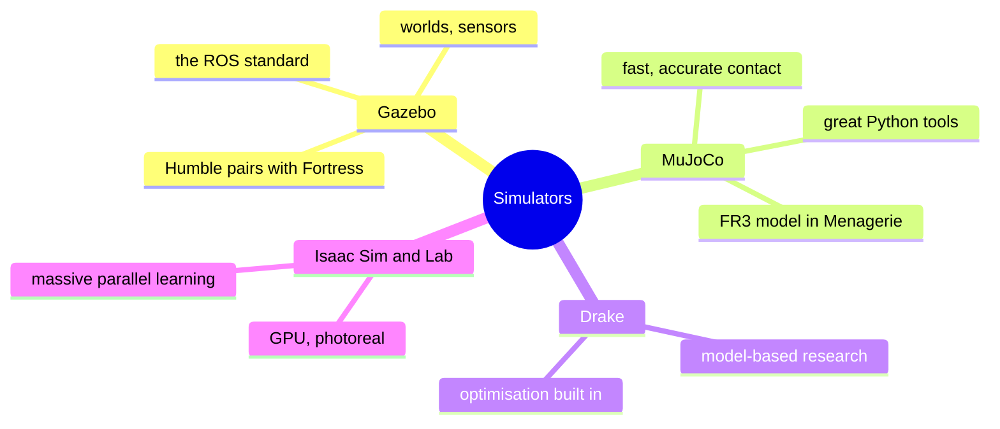
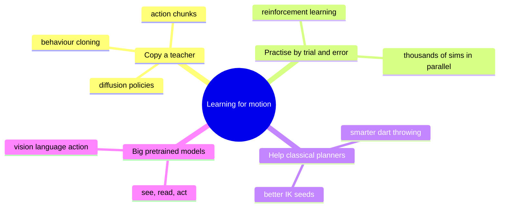
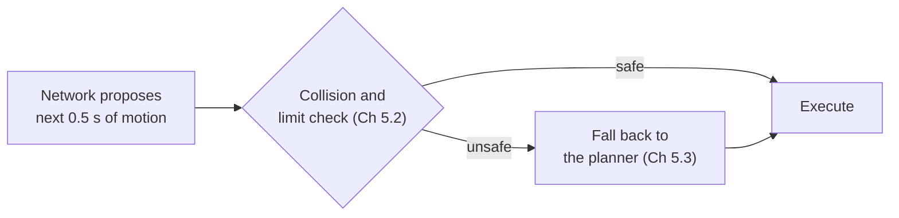
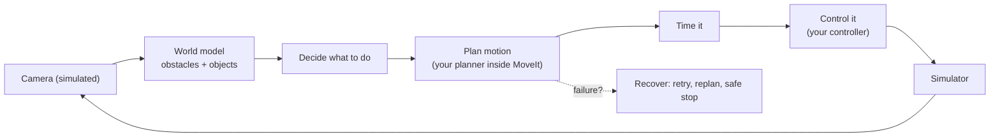

# Chapter 6 · Real world: frameworks, simulation, learning

You've now built every piece by hand. This last chapter covers how the pros assemble
those pieces (**MoveIt**), how they test them without breaking hardware
(**simulation**), where **machine learning** genuinely helps, and how to finish with
something worth showing people (the **capstone**).



---

## 6.1 · MoveIt 2: the conductor

*What does it take to click "Plan & Execute" in RViz and have the arm move safely?*

MoveIt owns no new maths. It conducts everything you've already met:



Headlines:
* **URDF + SRDF.** The SRDF adds planning words to the body description: *arm group*,
  *hand*, *ready pose*, *pairs of links that can never collide*.
* **Everything is a plugin,** so you can swap in your own planner or IK solver.
* **Task Constructor** turns "pick, carry, place" into a chain of small stages that are
  searched together.

**Look up:** *MoveIt 2 architecture*, *SRDF*, *planning scene monitor*, *planning
pipeline / request adapters*, *computeCartesianPath jump threshold*, *MoveIt Servo*,
*MoveIt Task Constructor*. Read the [MoveIt 2 docs](https://moveit.picknik.ai/main/index.html).

**🛠 Prove it:** Build a MoveIt setup for the FR3 from scratch, plug in *your* Chapter 5.3
planner, and do a pick-and-place with Task Constructor. *Passed when* your planner shows
up in RViz's list, holds its own against OMPL, and the pick-and-place succeeds on 20
random cube positions.

---

## 6.2 · Simulation: a safe rehearsal

*How do you test a controller that might slam the arm into the table?*

A simulator repeats one loop, thousands of times a second:



**Contact is the hard part.** Every simulator handles it differently, so the same push
gives different results in each. Choosing one:



Headlines:
* **Mock hardware is not simulation.** Lab 2's mirror has no physics, so swap it for a
  simulator and you'll see real tracking error for the first time.
* **Every node must follow the simulator's clock** (`use_sim_time`).
* **Simulation is not reality.** Friction, flexing, delays and noise all differ: the
  "sim-to-real gap". Randomising those properties in simulation builds robustness.

**In this repo:** `franka_description` already has `gazebo` switches and Gazebo
`ros2_control` hooks in its xacro files.

**Look up:** *contact models (complementarity, soft contact, hydroelastic)*,
*gz_ros2_control*, *mujoco_ros2_control*, *MuJoCo Menagerie franka_fr3*, *domain
randomisation*, *sim-to-real*. Read the "Computation" chapter of the
[MuJoCo docs](https://mujoco.readthedocs.io/).

**🛠 Prove it:** One controller, four "hardwares": mock, your own simulator (Ch 4.1),
Gazebo and MuJoCo, all behind the same launch switch. *Passed when* you've measured how
differently they track, push and grasp, and can explain *why* in terms of their contact
models.

---

## 6.3 · Learning: copying and practising

*When does a neural network beat the planners you've built, and when is it an
expensive way to rediscover inverse kinematics?*



Headlines:
* **Copying drifts.** One small mistake leads to a situation the teacher never showed
  you, and the mistakes snowball. (Fix: let the teacher correct you along the way.)
* **Averaging kills.** If half the demos go left round an obstacle and half go right,
  a naive network averages them and drives straight into it. Diffusion-style models fix
  this.

```text
   demos:   ↖ left     ↗ right          naive average:   ↑  straight into the obstacle 💥
               ▓▓▓                                         ▓▓▓
```

* **Safest pattern: the network proposes, the classical stack checks.**



**Look up:** *behaviour cloning*, *DAgger*, *action chunking (ACT)*, *Diffusion Policy*,
*PPO / SAC*, *residual RL*, *Motion Policy Networks*, *vision-language-action models*,
*LeRobot*. Watch Berkeley's [CS 285](https://rail.eecs.berkeley.edu/deeprlcourse/) and read
the [Diffusion Policy](https://diffusion-policy.cs.columbia.edu/) paper.

**🛠 Prove it:** Planner distillation. Generate 100k motions with your own planners, train
a policy to imitate them, and deploy it with the safety check above. *Passed when* you
report honestly where it beats your planner (speed, smoothness) and where it loses (new
kinds of scene), with error bars.

---

## 6.4 · Capstone: the whole orchestra

*Can you build a complete system that sees, plans, moves and recovers, and prove it
works?*



Pick one theme:
* **Cutting cell:** random plates and shapes, fully automatic.
* **Clutter clearing:** a moving "human hand" forces live replanning.
* **Dual-arm assembly:** two arms, one object.
* **Reproduce and extend a recent paper.**

*Passed when* it runs unattended on 50+ random trials with a success rate and error bars,
an automatic end-to-end test exists, at least one of your own components beats the
stock one, and you've written it up like a short paper with a 2-minute video. Real
hardware only with course-staff permission and supervision.

---

**The end of the story, and the start of yours.** You can now explain how a robot arm
gets its hand to the right place, at the right time, without hitting anything, from
the messages on the wire to the learned policy on top. Go back to the
[map](README.md) and pick your next lesson.
