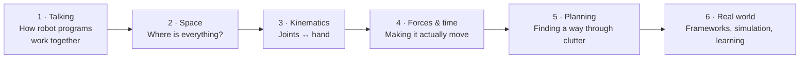
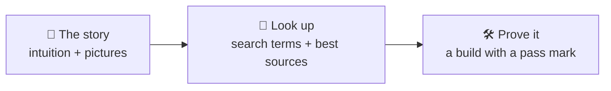
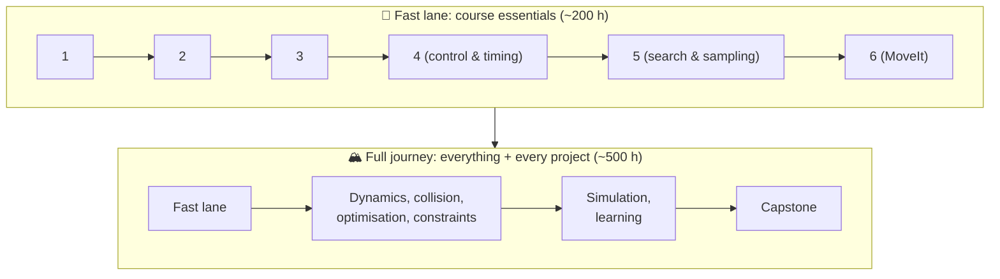
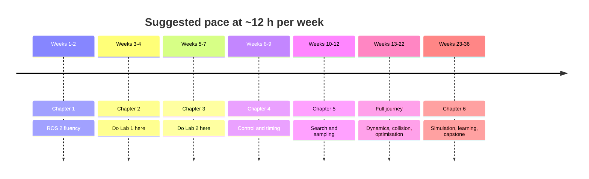
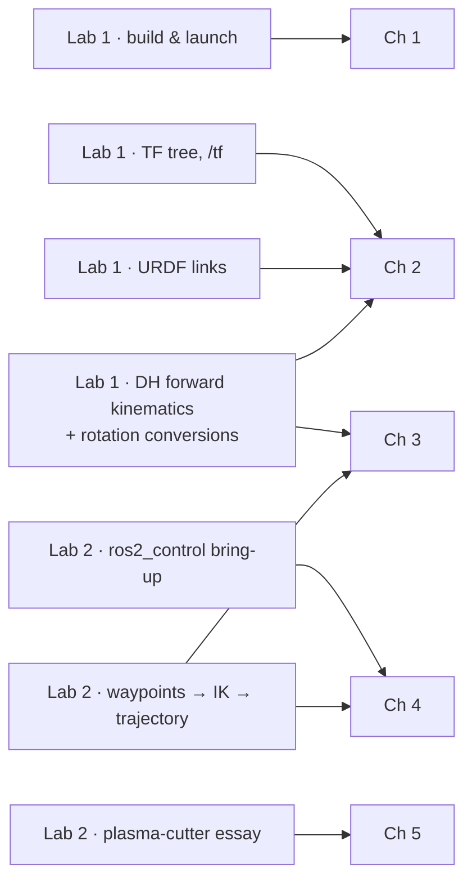

# The Robot Arm Story

How do you get a robot arm to move its hand somewhere useful without hitting anything?
That one question is the whole of *Modelling and Motion Planning*. This tutorial answers
it in six chapters, one layer at a time. Each layer is a problem the previous one leaves
open.

| Chapter | The question it answers |
|---|---|
| [1 · Talking](1-talking.md) | How do dozens of small programs cooperate to run one robot? (ROS 2) |
| [2 · Space](2-space.md) | How do we describe *where* and *which way round* things are? |
| [3 · Kinematics](3-kinematics.md) | Joint angles → hand pose, and the much harder reverse |
| [4 · Forces & time](4-forces-and-time.md) | What torques make that happen, and how fast may we go? |
| [5 · Planning](5-planning.md) | How do we get from A to B without hitting anything? |
| [6 · Real world](6-real-world.md) | How do the pros glue it together, test it, and teach it? |

## How each lesson works

Lessons give you the *shape* of an idea, never the full detail. The **Look up** line
lists the exact terms to search and the best place to read about them. The **Prove it**
project is how you find out whether you really understood. A project counts as passed
only when a number says so.

## Two lanes

## Where the labs fit

## Ground rules

* **Integrity.** The labs are assessed. This tutorial explains the ideas behind every
  TODO but never gives the answers. Build projects in your own workspace
  (`~/mamp_ws`), and check course policy before publishing anything that overlaps a
  lab.
* **Versions.** Do coursework on ROS 2 **Humble** (Ubuntu 22.04). Jazzy and Lyrical
  are the newer long-term releases; use them for side projects if a tool needs them.
* **Method.** Sketch the maths on paper → code it yourself → compare against a trusted
  library → measure. If you can't explain it to a friend in two minutes, go round again.

## The bookshelf

Four sources cover most of this tutorial. Everything else is linked from the lesson
that needs it.

* **Lynch & Park, *Modern Robotics*** (free, with short videos):
  [hades.mech.northwestern.edu](https://hades.mech.northwestern.edu/index.php/Modern_Robotics)
* **Siciliano et al., *Robotics: Modelling, Planning and Control*** (Springer, 2009)
* **LaValle, *Planning Algorithms*** (free): [lavalle.pl/planning](https://lavalle.pl/planning/)
* **ROS 2 docs** (Humble): [docs.ros.org/en/humble](https://docs.ros.org/en/humble/)

Start here → [Chapter 1 · Talking](1-talking.md)
