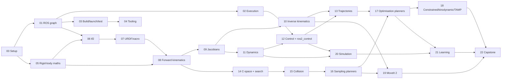

# MaMP Mastery Track: from ROS 2 internals to motion planning

A self-study programme for **Robot Modelling and Motion Planning** (COMP0246), built
around the code in this repository: the Lab 1 forward-kinematics/tf2 package, the Lab 2
IK + `ros2_control` trajectory package, and the Franka FR3 `franka_description`.

It assumes you are comfortable with **C++, Python, linear algebra, calculus and some
optimisation**, and that you have **never used ROS 2 or written robot software**. It takes
you from how bytes move between ROS 2 processes, through the mathematics of rigid-body
kinematics and dynamics, to sampling- and optimisation-based motion planning, physics
simulation and learned motion policies.

Each module pairs a **knowledge area** with **curated teaching material** (books,
lecture series, docs, papers) and an **ambitious mini project** whose acceptance criteria
are measurable. You prove competence with numbers, not by saying "it works".

---

## How a module is laid out

| Section | Purpose |
|---|---|
| **Why it matters / where it lives in this repo** | Links the topic to concrete files in `Lab1/`, `Lab2/` and `franka_description/` |
| **Learning objectives** | What you should be able to *do* afterwards |
| **Key ideas to own** | Condensed teaching notes: the definitions, equations and pitfalls you have to know cold |
| **Study materials** | *Core* (do these) and *Deeper* (for mastery), with what to take from each |
| **Warm-ups** | 1–3 hour exercises that make the ideas concrete |
| **Mini project** | A substantial build with a spec, **proof-of-competence criteria** and stretch goals |
| **Self-check** | Viva-style questions. If you can't answer one out loud in two minutes, revisit the module |

---

## The modules

| # | Module | Part | Est. hours* | Mini project |
|---|---|---|---|---|
| 00 | [Setup and professional workflow](00-setup-and-workflow.md) | 0 · Orientation | 8–12 | Reproducible dev container + CI that builds and smoke-tests this repo |
| 01 | [The ROS 2 graph: nodes, topics, services, actions, DDS, QoS](01-ros2-graph-and-communication.md) | I · ROS 2 foundations | 15–20 | Middleware latency/throughput lab across QoS, RMWs and languages |
| 02 | [Execution model: executors, callbacks, time, lifecycle](02-ros2-execution-model.md) | I | 12–18 | Deadlock clinic + a real-time-ish 1 kHz pipeline with jitter analysis |
| 03 | [Packages, build, launch, parameters and testing](03-ros2-packages-build-launch-test.md) | I | 12–16 | One parameterised multi-robot bringup with `launch_testing` integration tests |
| 04 | [Tooling, visualisation and debugging](04-ros2-tooling-visualisation-debugging.md) | I | 8–12 | Flight recorder: bag, offline MCAP analysis and a custom RViz marker visualiser |
| 05 | [Rigid-body transformations, rotations and Lie groups](05-rigid-body-transformations.md) | II · Modelling maths | 20–25 | `liegroups`: a tested SO(3)/SE(3) library in C++ (Eigen) with Python bindings |
| 06 | [tf2 and coordinate frames in ROS](06-tf2-and-frames.md) | II | 12–16 | tf2 from scratch: a time-buffered transform tree checked against `tf2_ros` |
| 07 | [Robot description: URDF, xacro, SDF, MJCF](07-robot-description-urdf-xacro.md) | II | 12–16 | Design a dual-FR3 torso robot as parameterised xacro with physical-validity tests |
| 08 | [Forward kinematics: DH, modified DH, product of exponentials](08-forward-kinematics.md) | III · Kinematics | 15–20 | Three-way FK cross-validation and an automatic URDF → MDH/PoE extractor |
| 09 | [Differential kinematics, Jacobians, singularities and statics](09-differential-kinematics.md) | III | 15–20 | Live manipulability ellipsoids in RViz + an FR3 singularity atlas |
| 10 | [Inverse kinematics and redundancy resolution](10-inverse-kinematics.md) | III | 20–30 | Your own IK library, benchmarked against KDL, TRAC-IK and analytic FR3 IK |
| 11 | [Rigid-body dynamics](11-rigid-body-dynamics.md) | IV · Dynamics and control | 25–35 | RNEA/CRBA/ABA from spatial algebra for the FR3, validated against Pinocchio |
| 12 | [Robot control and `ros2_control`](12-control-and-ros2-control.md) | IV | 25–35 | A C++ controller plugin + a hardware interface that runs *your* physics engine |
| 13 | [Trajectory generation and time parameterisation](13-trajectory-generation.md) | V · Trajectories | 20–25 | Glyph-to-motion: smooth Cartesian writing with TOPP-RA under FR3 limits |
| 14 | [Configuration space and graph-search planning](14-configuration-space-and-search.md) | VI · Motion planning | 15–20 | C-space visualiser and search-planner zoo (A*, ARA*, D* Lite, potential fields) |
| 15 | [Collision detection and distance computation](15-collision-detection.md) | VI | 20–25 | GJK/EPA + capsule self-collision for the FR3 at >1M checks/s |
| 16 | [Sampling-based motion planning](16-sampling-based-planning.md) | VI | 25–35 | 7-DoF RRT-Connect/RRT*/BIT* in C++, benchmarked against OMPL in Planner Arena |
| 17 | [Optimisation-based planning and optimal control](17-optimisation-based-planning.md) | VI | 25–35 | CHOMP + TrajOpt-style SQP + MPC, warm-started from your sampling planner |
| 18 | [Constrained, kinodynamic and task-level planning](18-constrained-kinodynamic-task-planning.md) | VI | 20–30 | The Lab 2 "plasma cutter", built for real: constrained, collision-free tool-path planning |
| 19 | [MoveIt 2](19-moveit2.md) | VII · Frameworks and simulation | 20–30 | FR3 MoveIt config from scratch, your planner as a plugin, MTC pick-and-place |
| 20 | [Physics simulation (Gazebo, MuJoCo, Drake, Isaac)](20-physics-simulation.md) | VII | 20–30 | One controller, four "hardwares": mock vs Gazebo vs MuJoCo vs your simulator |
| 21 | [Robot learning for motion](21-robot-learning-for-motion.md) | VIII · Learning | 25–40 | Planner distillation: a diffusion policy trained on your planner's demonstrations |
| 22 | [Capstone: an autonomous FR3 work cell](22-capstone.md) | IX · Capstone | 40–80 | Full stack: perception → planning → control → sim, with CI, benchmarks and a write-up |
| — | [Master resource list](resources.md) | Reference | — | Books, courses, channels, papers and libraries in one place |

\* Hours include study, warm-ups and the mini project for someone with your background.
Total: roughly **450–650 hours**. That is a year of serious part-time work. The two tracks
below tell you what to do first.

---

## Dependency graph



---

## Two tracks

### Track A: course-critical path (≈ 180–220 h)

Do the **Key ideas, Core materials and Warm-ups** of these modules in order. Do the mini
project wherever it's marked *(A)* inside the module.

`00 → 01 → 03 → 04 → 05 → 06 → 07 → 08 → 09 → 10 → 12 (ros2_control half) → 13 → 14 → 16 → 19`

This covers everything the labs touch, plus the planning core of the module, before the
deadlines arrive.

### Track B: mastery path (everything)

Track A first, then every mini project plus modules 02 (in full), 11, 15, 17, 18, 20, 21
and the capstone (22). Track B is the part that makes you *better than the course*: you
will have implemented, from scratch and benchmarked, every algorithm the course
mentions, and integrated them into the same middleware real robots use.

### Suggested calendar (≈ 12 h/week)

| Weeks | Focus |
|---|---|
| 1–2 | 00, 01, 03: get fluent with the ROS 2 CLI, write C++ and Python nodes, build packages |
| 3–4 | 05, 06, 07: rotations, quaternions, tf2, URDF. **Do Lab 1 here** |
| 5–7 | 08, 09, 10: FK, Jacobians, IK. **Do Lab 2 here** (also needs 12-lite and 13-lite) |
| 8–9 | 12 (ros2_control half), 13: controllers, JTC, time parameterisation |
| 10–12 | 14, 16, 19: C-space, sampling planners, MoveIt 2 |
| 13–16 | 02, 04 projects; 11 dynamics; 12 full (C++ controllers) |
| 17–22 | 15, 17, 18: collision, trajectory optimisation, constrained planning |
| 23–28 | 20, 21: simulation and learning |
| 29–36 | 22: capstone (aim for a portfolio piece or dissertation seed) |

---

## Where the labs fit

| Lab task | What it really tests | Modules |
|---|---|---|
| Lab 1, step 0–1.4: clone, `rosdep`, `colcon build`, launch | Workspaces, overlays, dependency resolution, launch | 00, 03 |
| Lab 1, step 1.5–1.6: `view_frames`, `ros2 topic echo /tf` | tf2 tree, `TFMessage`, quaternions | 04, 05, 06 |
| Lab 1, step 1.7: count links in the URDF | Links vs joints, fixed joints, virtual frames | 07 |
| Lab 1, step 2: modified-DH FK node broadcasting TF | Craig MDH convention, homogeneous transforms, rotation→quaternion, pub/sub, `TransformBroadcaster` | 01, 05, 06, 08 |
| Lab 1, `utils.py`: `rotmat2q`, `quat2rodrigues`, `quat2zyx` | Rotation parameterisations and their numerics | 05 |
| Lab 2, step 0: mock-hardware bringup, `ros2 topic pub` a `JointTrajectory` | `ros2_control`, controller manager, JTC, message YAML | 01, 12 |
| Lab 2, step 1: Cartesian waypoints → IK → `JointTrajectory`, FK via tf2 lookup, plotting | KDL LMA IK, seeding, `time_from_start`, `tf2_ros.Buffer` | 06, 10, 13 |
| Lab 2, step 2: draw initials, time the motion | Workspace limits, waypoint density, timing | 09, 10, 13 |
| Lab 2, step 3: orientation targets | RPY conventions, 6-D IK, orientation plotting | 05, 10 |
| Lab 2, step 4: plasma-cutter control strategies (essay) | Constrained Cartesian planning, collision avoidance, tool-axis constraints, velocity profiles | 13, 17, 18 |

> **Academic integrity.** The labs are assessed coursework. This tutorial explains the
> concepts behind every TODO and points at the relevant files, but it deliberately does
> **not** contain solutions to lab TODOs or answers to report questions. Mini projects
> go further than the labs and live in your own workspace (`~/mamp_ws`), not in
> `Lab1/` or `Lab2/`. Check your department's policy before publishing any project code
> that overlaps a lab task (e.g. the Module 13 writing project), and never submit tutorial
> project code as lab work.

---

## Version choices (October 2026)

* **The course uses ROS 2 Humble** (Ubuntu 22.04, end of life May 2027). Do all
  coursework on Humble.
* **Jazzy** (Ubuntu 24.04, LTS to May 2029, pairs with Gazebo Harmonic) and **Lyrical
  Luth** (Ubuntu 26.04, LTS to May 2031, pairs with Gazebo Jetty) are the current LTS
  releases. Some newer tooling (e.g. binary `mujoco_ros2_control`) ships for Jazzy and
  later only. For mini projects, it is reasonable to keep a second Jazzy container
  (Module 00 shows how).
* APIs differ slightly between distributions. When docs disagree with your system,
  check that the docs URL contains your distro name (`/en/humble/`).

---

## Competence ladder

Use this to judge where you are. Each level requires the artefacts in the right-hand column.

| Level | You can… | Evidence |
|---|---|---|
| 1. User | Launch, inspect and debug existing ROS 2 systems; explain every node and topic in `Lab2`'s bringup | A one-page annotated `rqt_graph` of Lab 2 |
| 2. Builder | Write C++ and Python nodes, packages, launch files and tests; describe a robot in xacro | Projects 01–04, 07 |
| 3. Modeller | Derive and implement FK, Jacobians, IK and dynamics for any serial arm from its URDF, and prove them correct numerically | Projects 05, 08–11 |
| 4. Planner | Implement, analyse and benchmark sampling-based and optimisation-based planners on a 7-DoF arm; integrate them in MoveIt 2 | Projects 13–19 |
| 5. Systems researcher | Build and evaluate full stacks in simulation, reason about sim-to-real, combine classical planning with learning, and write it up like a paper | Projects 20–22 |

---

## How to study this material

1. **Derive before you code.** For every algorithm, write the maths on paper first
   (a few lines of LaTeX in your notes is ideal).
2. **Implement from scratch, then compare with a reference library.** Your FK against
   tf2/KDL/Pinocchio, your planner against OMPL. Agreement to ~1e-12 (or a benchmark
   table) is the proof.
3. **Test numerically.** Finite differences for every derivative. Property-based tests
   (`hypothesis`) for every group operation. Randomised configurations, never a single
   hand-picked one.
4. **Measure.** Time, success rate, path length, jerk, tracking error. Plot distributions,
   not means.
5. **Write one page per module** in your own words. If you can't teach it, you don't
   know it yet.
6. **Keep a portfolio workspace**:

```
~/mamp_ws/
  src/
    mamp_bringup/          # launch, configs (Modules 03, 19, 20)
    mamp_liegroups/        # Module 05 (C++ + pybind11)
    mamp_tf_scratch/       # Module 06
    mamp_description/      # Module 07 (dual-arm xacro)
    mamp_kinematics/       # Modules 08–10 (FK, Jacobians, IK)
    mamp_dynamics/         # Module 11
    mamp_controllers/      # Module 12 (ros2_control plugins)
    mamp_trajectories/     # Module 13
    mamp_collision/        # Module 15
    mamp_planners/         # Modules 14, 16–18
    mamp_moveit_config/    # Module 19
    mamp_sim/              # Module 20
    mamp_learning/         # Module 21
  benchmarks/              # CSVs, plots and reports for every project
  notes/                   # one page per module
```

Start with [Module 00](00-setup-and-workflow.md).
